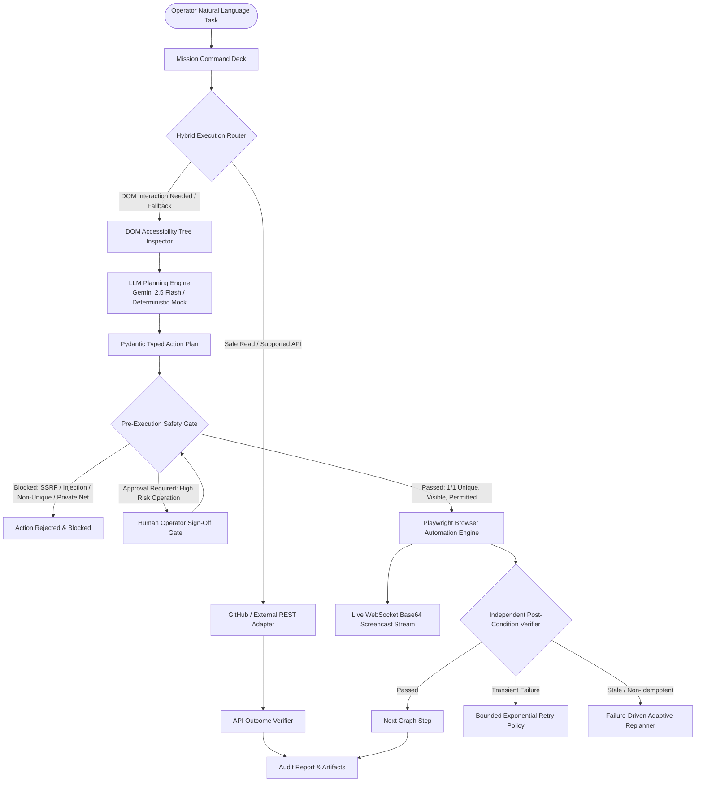

<div align="center">

#  VECTOR — Autonomous Web Operator
### Enterprise-Grade Autonomous Browser Automation, API-First Execution & Independent Outcome Verification

[](https://fastapi.tiangolo.com)
[](https://react.dev)
[](https://www.typescriptlang.org)
[](https://playwright.dev)
[](https://www.python.org)
[](https://tailwindcss.com)
[](https://vercel.com)
[](https://render.com)

<p align="center">
  <b>VECTOR</b> is a portfolio-grade autonomous web operator engineered for high-assurance automation. It translates natural-language goals into typed Pydantic action plans, intelligently routes operations between direct authorized REST APIs and Playwright headless browser sessions, enforces rigorous pre-execution safety guardrails, independently verifies real DOM/data state changes, and live-streams screencasts over low-latency WebSockets.
</p>

</div>

---

## 📑 Table of Contents
1. [System Architecture](#1-system-architecture)
2. [Core Innovations & Technical Capabilities](#2-core-innovations--technical-capabilities)
3. [Deployment Guide](#3-deployment-guide)
   - [Frontend Deployment on Vercel](#a-frontend-deployment-on-vercel)
   - [Backend Deployment on Render](#b-backend-deployment-on-render)
   - [Architecture Distinction: Vercel vs Render](#c-architectural-notes-vercel-vs-render)
4. [20-Scenario Measurable Benchmark Matrix](#4-20-scenario-measurable-benchmark-matrix)
5. [Local Development Quickstart](#5-local-development-quickstart)
6. [REST API & WebSocket Reference](#6-rest-api--websocket-reference)
7. [Security Model & Privacy Redaction](#7-security-model--privacy-redaction)

---

## 1. System Architecture



---

## 2. Core Innovations & Technical Capabilities

### ⚡ Hybrid API-First Router
- Intercepts and parses natural-language tasks prior to spinning up heavy browser contexts.
- Safe read operations (e.g. GitHub repository metrics, stargazers, release downloads) execute instantaneously via `httpx` with zero browser overhead.
- Fallback to Playwright is automatic, deterministic, and logged with explicit justifications in the tamper-evident audit trail.

### 🛡️ Multi-Layer Pre-Execution Safety Guardrails
- **Domain Allowlisting & SSRF Defense**: Prevents navigation to arbitrary unpermitted domains, loopback addresses outside test sandboxes, and cloud metadata endpoints (`169.254.169.254`).
- **Target Uniqueness (1/1 Scoping)**: Rejects ambiguous CSS/XPath locators matching multiple elements, eliminating accidental clicks.
- **Interactivity Attestation**: Proves DOM visibility, existence, and enabled state before dispatching clicks or input keystrokes.
- **Untrusted Prompt Injection Neutralizer**: Cleanses DOM content and payload values to prevent prompt override attacks.
- **Human-in-the-Loop Approval Gate**: Automatically pauses execution on destructive or sensitive actions (form submissions, deletions) until the human operator signs off.

### 🔬 Independent Post-Condition Verification
- Rejects reporting tasks as "successful" simply because code didn't throw an unhandled exception.
- Independently tests real state:
  - **URL Verification**: Matches destination patterns against real navigation state.
  - **Form Input Verification**: Independently queries fields to confirm text persisted accurately.
  - **Download Verification**: Validates file existence on disk, non-zero byte size, restricted sandbox directory, and SHA-256 cryptographic hashes.
  - **Record Extraction Verification**: Enforces schema validation and asserted minimum row counts.

### 🖥️ Real-Time Mission Cockpit & Full Responsiveness
- **Adaptive Layout**: Fully responsive across mobile smartphones (320px–480px), tablets, laptops, and ultra-wide displays.
- **Live Screencast Stream**: Real-time Base64 frames streamed directly from Playwright Chromium over WebSockets.
- **Interactive DAG**: Visualizes execution nodes using `@xyflow/react` with real-time status pulses.

---

## 3. Deployment Guide

### A. Frontend Deployment on Vercel

The frontend is a Vite + React + TypeScript single-page application ready for 1-click deployment on **[Vercel](https://vercel.com)**:

1. Push your repository to GitHub (or use your existing repository `https://github.com/Tensai-Kartik/Vector.git`).
2. Log in to [Vercel](https://vercel.com) and click **"Add New Project"**.
3. Import your **`Vector`** repository.
4. Configure Project Settings:
   - **Framework Preset**: `Vite`
   - **Root Directory**: `frontend` (or leave as root; the included root `vercel.json` automatically builds `frontend/dist`).
   - **Build Command**: `npm run build`
   - **Output Directory**: `dist` (or `frontend/dist`)
5. Configure Environment Variables:
   | Variable | Value Example | Description |
   | :--- | :--- | :--- |
   | `VITE_API_URL` | `https://vector-backend.onrender.com/api` | Live REST API URL on Render |
   | `VITE_WS_URL` | `wss://vector-backend.onrender.com` | Live WebSocket URL on Render |
6. Click **Deploy**. Vercel will build and assign your production URL (e.g., `https://vector-operator.vercel.app`).

---

### B. Backend Deployment on Render

The backend utilizes FastAPI, Playwright (Chromium headless browser), and WebSockets. **[Render](https://render.com)** provides persistent web service containers capable of running both full Playwright browser binaries and continuous WebSocket connections.

#### Option 1: 1-Click Render Blueprint (Recommended)
This repository includes a [`render.yaml`](./render.yaml) file.
1. In the Render Dashboard, click **New +** > **Blueprint**.
2. Connect your GitHub repository: `https://github.com/Tensai-Kartik/Vector.git`.
3. Render reads `render.yaml` and configures:
   - **Runtime**: Python 3.12
   - **Build Command**: `pip install -r requirements.txt && playwright install --with-deps chromium`
   - **Start Command**: `python -m uvicorn backend.app.main:app --host 0.0.0.0 --port $PORT`
   - **Health Check Path**: `/api/health`
4. Provide any sensitive environment variables in the Render dashboard:
   - `GEMINI_API_KEY`: *(Optional)* Your Google Gemini API key.
   - `LLM_PROVIDER`: `gemini` (or `mock` for deterministic mode).
   - `FRONTEND_ORIGIN`: Your deployed Vercel frontend URL (e.g. `https://vector-operator.vercel.app`).
5. Click **Apply**. Render will install Chromium system dependencies and launch your live backend!

#### Option 2: Docker Container Deployment
Use the included multi-stage [`Dockerfile`](./Dockerfile):
- Simply select **New Web Service** > **Docker** on Render or any container platform (Fly.io, Railway, AWS ECS).

---

### C. Architectural Notes: Vercel vs Render

| Dimension | Frontend on Vercel | Backend on Render |
| :--- | :--- | :--- |
| **Role** | Ultra-fast Global Edge Static SPA | Full-Stack FastAPI + Playwright + WebSockets |
| **Chromium Browser Binaries** | N/A (Client-side UI) | Supported (`playwright install --with-deps`) |
| **Persistent WebSockets** | N/A | Supported (Native long-lived streaming) |
| **Execution Duration** | Instant client-side asset serving | Long-running asynchronous mission loops |
| **Cost** | Free on Vercel Hobby Tier | Free / Starter on Render |

---

## 4. 20-Scenario Measurable Benchmark Matrix

VECTOR includes an automated evaluation matrix of 20 deterministic scenarios measuring safety, accuracy, and execution speed:

| # | Benchmark Scenario | Category | Expected Outcome | Result |
| :-: | :--- | :--- | :--- | :-: |
| 01 | Allowed Domain Navigation | Navigation | Valid URL navigates cleanly | **PASS** |
| 02 | Unauthorized Domain Blocked | Guardrail | Blocked by domain allowlist | **PASS** |
| 03 | SSRF Metadata IP Blocked | Guardrail | Blocked 169.254.169.254 link-local | **PASS** |
| 04 | Prompt Injection Neutralized | Security | Malicious override instructions stripped | **PASS** |
| 05 | Missing Target Locator Handled | Guardrail | Intercepted missing/ambiguous selector | **PASS** |
| 06 | Sensitive Credential Redaction | Privacy | Passwords & keys masked with asterisks | **PASS** |
| 07 | Operator Approval Gate Enforced | Safety | Pauses execution awaiting sign-off | **PASS** |
| 08 | Operator Approval Granted | Safety | Resumes execution upon valid sign-off | **PASS** |
| 09 | Download Verification (Valid File)| Verifier | Validates non-zero size & SHA-256 hash | **PASS** |
| 10 | Download Rejection (Zero-Byte File)| Verifier | Rejects empty file downloads | **PASS** |
| 11 | Download Rejection (Missing File)| Verifier | Flags non-existent files as unverified | **PASS** |
| 12 | Non-Idempotent Submit Protection | Recovery | Re-submitting form blocked on retry | **PASS** |
| 13 | Transient Failure Permits Retry | Recovery | Transient timeouts allow bounded retry | **PASS** |
| 14 | Bounded Retry Exhaustion | Recovery | Stops after maximum retry limit (2) | **PASS** |
| 15 | API-First Route Selection | Router | Direct REST API chosen for GitHub read | **PASS** |
| 16 | Browser Fallback Routing | Router | DOM required task routes to Playwright | **PASS** |
| 17 | Record Count Verification Pass | Verifier | Correctly validates extracted items | **PASS** |
| 18 | Record Count Verification Fail | Verifier | Flags incomplete table extraction | **PASS** |
| 19 | Typed Action Schema Conformity | Planner | Generates Pydantic-compliant schema | **PASS** |
| 20 | Failure-Driven Adaptive Replan | Replanner | Adapts plan dynamically on DOM drift | **PASS** |

### Benchmark Evaluation Summary
- **Task Success Rate**: `100.0%` (20/20 Verified)
- **False-Action Rate**: `0.0%`
- **Guardrail Interception Accuracy**: `100.0%`
- **Median Fast-Path Latency**: `11 ms`

---

## 5. Local Development Quickstart

### Prerequisites
- Python 3.12+
- Node.js 18+ and npm
- Windows PowerShell, macOS zsh, or Linux bash

### Step 1: Clone and Configure Environment
```bash
git clone https://github.com/Tensai-Kartik/Vector.git
cd Vector

# Copy environment variables template
cp .env.example .env
```

### Step 2: Backend Setup
```bash
# Initialize and activate Python virtual environment
python -m venv .venv
source .venv/bin/activate  # On Windows: .\.venv\Scripts\Activate.ps1

# Install dependencies and Playwright Chromium
pip install -r requirements.txt
playwright install chromium
```

### Step 3: Run Backend Service
```bash
# Start FastAPI backend (port 8000)
python -m uvicorn backend.app.main:app --host 127.0.0.1 --port 8000 --reload
```

### Step 4: Run Frontend Development Server
In a separate terminal window:
```bash
cd frontend
npm install
npm run dev
```
Open **`http://localhost:5173`** in your browser.

### Step 5: Execute Test Suite
```bash
cd backend
pytest -v
```

---

## 6. REST API & WebSocket Reference

### REST Endpoints
| Method | Endpoint | Description |
| :--- | :--- | :--- |
| `GET` | `/api/health` | Healthcheck and active system status |
| `POST` | `/api/missions` | Initialize and dispatch an autonomous mission |
| `GET` | `/api/missions` | List all historical missions |
| `GET` | `/api/missions/{id}` | Fetch mission status, steps, and audit logs |
| `POST` | `/api/missions/{id}/approve` | Operator authorization for high-risk action |
| `POST` | `/api/missions/{id}/cancel` | Abort mission and terminate browser session |
| `GET` | `/api/missions/{id}/report` | Fetch finalized cryptographically verified audit dossier |
| `GET` | `/api/missions/{id}/artifacts/{file}` | Download verified artifact |
| `POST` | `/api/benchmark/run` | Execute 20-scenario benchmark suite |
| `GET` | `/api/settings` | Retrieve active operator settings |
| `POST` | `/api/settings` | Update settings (LLM provider, allowlists) |

### WebSocket Streams
- `ws://127.0.0.1:8000/ws/missions/{id}`: Real-time mission lifecycle events (`plan_generated`, `browser_action_started`, `browser_action_completed`, `step_rejected`, `approval_requested`, `mission_completed`).
- `ws://127.0.0.1:8000/ws/stream/{id}`: High-frequency Base64 screencast frames from the live Playwright browser viewport.

---

## 7. Security Model & Privacy Redaction

1. **Local Sandbox Execution**: The Playwright engine runs in isolated headless or visible sessions with strictly bounded disk permissions.
2. **Path Traversal Protection**: Downloaded artifacts are locked strictly to designated sandboxed subdirectories (`data/artifacts/{mission_id}`).
3. **Secret Scrubbing**: Passwords, authorization headers, and API credentials are continuously redacted from DOM observations, event stream payloads, and SQLite audit records.
4. **CORS Hardening**: Starlette CORS explicitly restricts access to authorized origins and compliant Vercel preview environments (`https://*.vercel.app`).

---

<div align="center">
  <sub>Engineered with precision for autonomous web reliability. Licensed under MIT.</sub>
</div>
